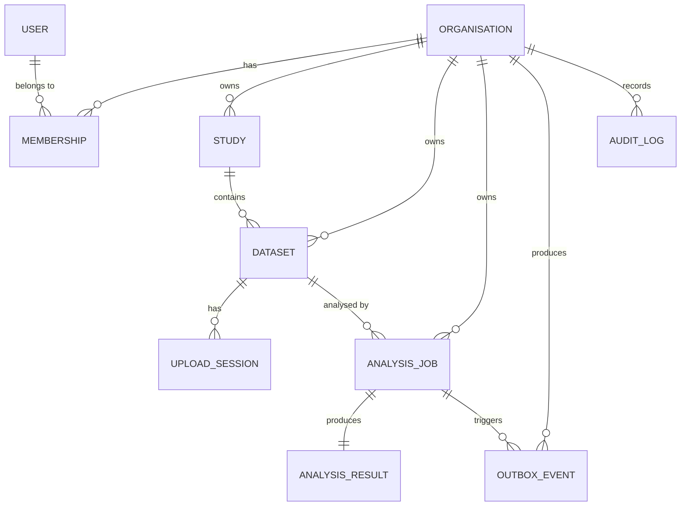

# NeuroLab


NeuroLab is a full-stack scientific SaaS demonstration for neuroscience researchers: organise studies, upload EEG recordings, explore neural signals, run asynchronous descriptive analyses, and share results inside organisation-scoped workspaces.

> **Research software demonstration only.** NeuroLab does not diagnose conditions, recommend treatment, or claim clinical validity.

## Demo

A screen-capture walkthrough is available at [`demo/neurolab-demo.mp4`](demo/neurolab-demo.mp4) (1 MB). It demonstrates:

- Sign-in and organisation-scoped workspace
- Study creation and dataset registration with metadata
- Synthetic EEG upload, checksum verification, and validation lifecycle
- Interactive signal visualisation on the dataset detail page (channel selection, time-window controls, Plotly.js time-series chart)
- Analysis submission with idempotency key, status tracking, cancellation for queued jobs
- Analysis detail page with job provenance, per-channel descriptive statistics, and signal visualisation


## Overview

NeuroLab implements a complete vertical slice for neuroscience research workflows:

- **Studies & Datasets** — Create, search, filter, and paginate studies; register dataset metadata (format, channels, sampling frequency, expected checksum, source description)
- **EEG Upload & Validation** — Direct-to-storage upload sessions with backend-mediated content endpoint, `.npy` structure/metadata validation, SHA-256 checksum and size verification, deterministic lifecycle transitions
- **Asynchronous Analysis Pipeline** — Idempotent job submission, transactional outbox + Celery/Redis dispatcher, bounded retries with durable job state, cooperative cancellation, lease-based stale-job recovery
- **Descriptive Statistics** — Per-channel mean, standard deviation (population, ddof=0), min, max, peak-to-peak, valid sample count; excludes non-finite samples; provenance recorded (dataset checksum, algorithm version, parameters, result schema version)
- **Scientific Visualisation** — Interactive time-series charts (Plotly.js) with channel selector, sampling-frequency-aware time axes, configurable windows, prev/next navigation, and accessible data-table alternatives
- **Organisation-scoped Tenancy** — All resources scoped to organisations; roles (owner, member, viewer) enforce write/read permissions; cross-tenant access denied at API and UI layers

## Features

| No  | Feature                | Description                                                                                           |
| --- | ---------------------- | ----------------------------------------------------------------------------------------------------- |
| 1   | Study management       | Create, list (search + status filter + cursor pagination), detail, update, archive                    |
| 2   | Dataset registration   | Format, channel count, channel names/units, sampling frequency, expected checksum, source             |
| 3   | EEG upload             | Resumable upload sessions, `.npy` validation, checksum verification, status transitions               |
| 4   | Analysis submission    | Idempotency keys, bounded retries (3 attempts), queued/running/succeeded/failed/cancelled states      |
| 5   | Descriptive statistics | Mean, std (pop), min, max, peak-to-peak, valid sample count per channel                               |
| 6   | Signal visualisation   | Channel selection, time-window controls, Plotly.js charts, downsampling indicator, data summary table |
| 7   | Analysis results       | Provenance metadata, per-channel statistics grid, signal visualisation on detail page                 |
| 8   | Tenancy & roles        | Organisation-scoped data, role-based access control (owner/member/viewer)                             |
| 9   | Observability          | Structured JSON logging (request/job correlation IDs), Prometheus `/metrics` endpoint                 |
| 10  | End-to-end tests       | Full workflow Playwright suite against live stack (optional, requires `NEUROLAB_E2E_API_BASE`)        |

## Architecture

```text
Browser (Next.js + React + TypeScript + Plotly.js)
        │
        ▼
tRPC BFF (Next.js)
        │
        ▼
FastAPI REST API ── explicit SQL ──► PostgreSQL
        │                                ▲
        │  transactional outbox          │ authoritative job state
        ▼                                │
     Redis ─────────────► Celery worker ─┘
                               │
                               └──► private object storage (NumPy recordings)
```

Design details live in `docs/05-architecture.md` and `docs/06-data-model.md`.

## Data Model

Core entities (see `docs/06-data-model.md` for schema):

- **Organisation** — Tenancy boundary; owns studies, datasets, analyses, members
- **Membership** — User ↔ Organisation with role (`owner`, `member`, `viewer`)
- **Study** — Research project within an organisation; status (`active`, `archived`)
- **Dataset** — EEG recording metadata + file reference; status (`pending_upload`, `validating`, `ready`, `rejected`, `failed`)
- **UploadSession** — Direct-to-storage upload token + metadata; expires after 1 hour
- **AnalysisJob** — Asynchronous analysis request; status (`queued`, `running`, `succeeded`, `failed`, `cancelled`); attempt tracking, idempotency key
- **AnalysisResult** — Per-channel descriptive statistics + provenance (dataset checksum, algorithm version, parameters, schema version)
- **OutboxEvent** — Transactional outbox for dispatcher reliability
- **AuditLog** — Immutable security-relevant action trail

All timestamps are ISO 8601 UTC; UUIDs identify resources; unknown request fields rejected on writes.



## Tech stack

### Frontend

| No  | Layer                     | Technology                                                                      | Version | Purpose                                                                  |
| --- | ------------------------- | ------------------------------------------------------------------------------- | ------- | ------------------------------------------------------------------------ |
| 1   | **Framework**             | [Next.js (App Router)](https://nextjs.org/)                                     | 16.x    | React framework with server components, streaming, partial pre-rendering |
| 2   | **UI Library**            | [React](https://react.dev/)                                                     | 19.x    | Component model, hooks, concurrent features                              |
| 3   | **Language**              | [TypeScript](https://www.typescriptlang.org/)                                   | 5.x     | Strict mode, no `any`, tRPC end-to-end types                             |
| 4   | **Styling**               | [Tailwind CSS](https://tailwindcss.com/)                                        | 4.x     | Utility-first, design tokens from `docs/09-design.md`                    |
| 5   | **Component Layer**       | [daisyUI](https://daisyui.com/)                                                 | 5.x     | Accessible, themeable components on Tailwind                             |
| 6   | **Charts**                | [Plotly.js](https://plotly.com/javascript/)                                     | 3.x     | WebGL `scattergl` for 5k+ points, downsampling, pan/zoom, hover          |
| 7   | **State / Data Fetching** | [TanStack Query](https://tanstack.com/query/latest) (via tRPC)                  | 5.x     | Caching, invalidation, optimistic updates                                |
| 8   | **Type-Safe API Layer**   | [tRPC](https://trpc.io/)                                                        | 11.x    | End-to-end types, procedures, middleware, BFF pattern                    |
| 9   | **Testing**               | [Vitest](https://vitest.dev/), [Testing Library](https://testing-library.com/)  | —       | Unit, component, RSC-compatible                                          |
| 10  | **E2E Testing**           | [Playwright](https://playwright.dev/)                                           | —       | Full workflow, tenant isolation, Chromium                                |
| 11  | **Lint / Format**         | [ESLint](https://eslint.org/), [Prettier](https://prettier.io/), `tsc --noEmit` | —       | 0 errors, strict TypeScript                                              |
| 12  | **Security Scanning**     | [npm audit](https://docs.npmjs.com/cli/v10/commands/npm-audit)                  | —       | CI integration, SARIF upload                                             |

### Backend

| No  | Layer                 | Technology                                                                    | Version | Purpose                                                   |
| --- | --------------------- | ----------------------------------------------------------------------------- | ------- | --------------------------------------------------------- |
| 1   | **API Framework**     | [FastAPI](https://fastapi.tiangolo.com/)                                      | 0.115.x | Async, OpenAPI, Pydantic validation, dependency injection |
| 2   | **Language**          | [Python](https://www.python.org/)                                             | 3.12    | Type hints, `uv` package manager                          |
| 3   | **Validation**        | [Pydantic](https://docs.pydantic.dev/)                                        | 2.x     | `extra="forbid"`, custom types, model serialisation       |
| 4   | **Database Driver**   | [Psycopg](https://www.psycopg.org/psycopg3/)                                  | 3.x     | Async, prepared statements, COPY, connection pooling      |
| 5   | **Database**          | [PostgreSQL](https://www.postgresql.org/)                                     | 16      | ACID, JSONB, advisory locks, `FOR UPDATE SKIP LOCKED`     |
| 6   | **Cache / Broker**    | [Redis](https://redis.io/)                                                    | 7.x     | Celery broker, idempotency keys, session cache            |
| 7   | **Authentication**    | [JWT](https://jwt.io/) (HS256 dev / RS256 prod)                               | —       | `X-Request-Id` correlation, HttpOnly cookies via BFF      |
| 8   | **Testing**           | [pytest](https://docs.pytest.org/), [HTTPX](https://www.python-httpx.org/)    | —       | Unit, API, integration, security; real PostgreSQL         |
| 9   | **Lint / Format**     | [Ruff](https://docs.astral.sh/ruff/), [mypy](https://mypy-lang.org/) (strict) | —       | 119 files, 0 errors, 94% coverage                         |
| 10  | **Security Scanning** | [pip-audit](https://pypi.org/project/pip-audit/), [Trivy](https://trivy.dev/) | —       | CI integration, SARIF upload                              |

### Async Processing

| No  | Layer             | Technology                          | Version | Purpose                                                         |
| --- | ----------------- | ----------------------------------- | ------- | --------------------------------------------------------------- |
| 1   | **Async Workers** | [Celery](https://docs.celeryq.dev/) | 5.x     | Task routing, concurrency, time limits, no result backend       |
| 2   | **Task Dispatch** | Custom Outbox Dispatcher            | —       | `FOR UPDATE SKIP LOCKED`, exponential backoff, 100-year parking |

### Storage

| No  | Layer                    | Technology                                                | Version | Purpose                                                                 |
| --- | ------------------------ | --------------------------------------------------------- | ------- | ----------------------------------------------------------------------- |
| 1   | **Storage Adapter**      | Local FS ([GCS target](https://cloud.google.com/storage)) | —       | Streaming upload, SHA-256, mmap `.npy` (no pickle)                      |
| 2   | **Scientific Computing** | [NumPy](https://numpy.org/)                               | 2.x     | `(channels, samples)` arrays, population std (ddof=0), vectorised stats |

### Ops

| No  | Layer                | Technology                                                                                           | Version | Purpose                                                                    |
| --- | -------------------- | ---------------------------------------------------------------------------------------------------- | ------- | -------------------------------------------------------------------------- |
| 1   | **Containerisation** | [Docker](https://www.docker.com/), [Docker Compose](https://docs.docker.com/compose/)                | —       | Multi-stage builds, non-root users, health checks                          |
| 2   | **IaC**              | [Terraform](https://www.terraform.io/)                                                               | 1.x     | GCP modules (network, Cloud SQL, Memorystore, Cloud Run, Storage, Secrets) |
| 3   | **CI/CD**            | [GitHub Actions](https://github.com/features/actions), [Cloud Build](https://cloud.google.com/build) | —       | Parallel jobs, concurrency cancel, build → test → deploy                   |

## Supplementary Documentation

| No  | Document                                                                                           | Description                                                                                                                                   |
| --- | -------------------------------------------------------------------------------------------------- | --------------------------------------------------------------------------------------------------------------------------------------------- |
| 1   | [`docs/supplementary/architecture-diagrams.md`](docs/supplementary/architecture-diagrams.md)       | Mermaid diagrams: system architecture, request lifecycles, tenant isolation, outbox pattern, job state machine, data model, deployment target |
| 2   | [`docs/supplementary/case-study.md`](docs/supplementary/case-study.md)                             | Portfolio case study: problem statement, engineering decisions, technical highlights, challenges, metrics                                     |
| 3   | [`docs/supplementary/database-backup-recovery.md`](docs/supplementary/database-backup-recovery.md) | Backup strategies (pg_dump, PITR), recovery procedures, RTO/RPO, monitoring alerts                                                            |
| 4   | [`docs/supplementary/infrastructure-costs.md`](docs/supplementary/infrastructure-costs.md)         | GCP cost estimates (dev/prod), optimisation tips, teardown instructions, budget alerts                                                        |
| 5   | [`docs/supplementary/known-limitations.md`](docs/supplementary/known-limitations.md)               | Comprehensive limitations tracker across scientific, technical, operational, data model, documentation                                        |
| 6   | [`docs/supplementary/threat-model.md`](docs/supplementary/threat-model.md)                         | STRIDE threat model with trust boundaries, attack surface, controls matrix, residual risks                                                    |

## License

NeuroLab is released under the [MIT License](LICENSE).
