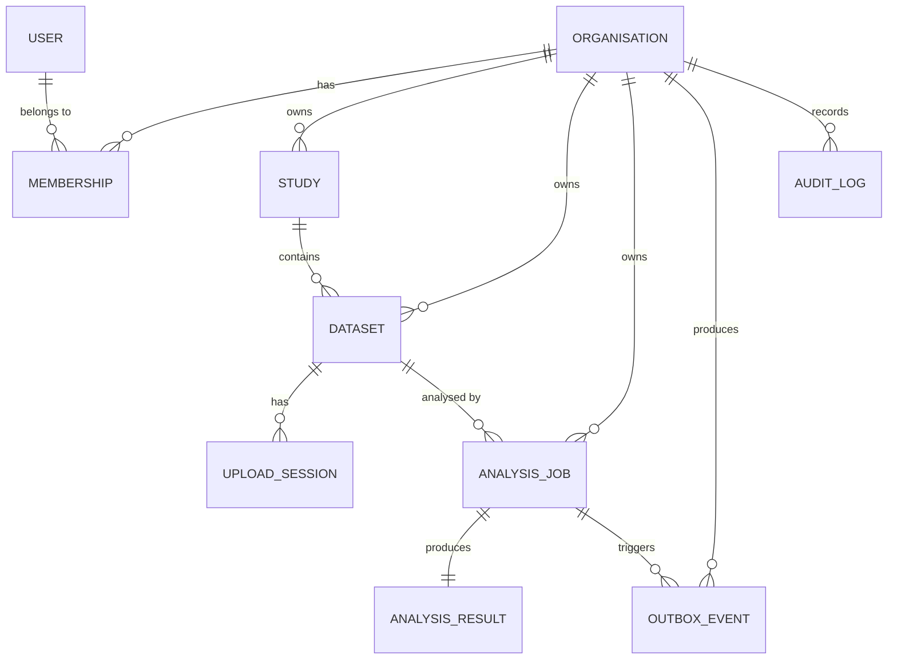

# NeuroLab


NeuroLab is a full-stack scientific SaaS demonstration for neuroscience researchers: organise studies, upload EEG recordings, explore neural signals, run asynchronous descriptive analyses, and share results inside organisation-scoped workspaces.

> **Research software demonstration only.** NeuroLab does not diagnose conditions, recommend treatment, or claim clinical validity.

## Demo

A screen-capture walkthrough is available at [`demo/neurolab-demo.mp4`](demo/neurolab-demo.mp4) (1 MB). It demonstrates:

- Sign-in and organisation-scoped workspace
- Study creation and dataset registration with metadata
- Synthetic EEG upload, checksum verification, and validation lifecycle
- Interactive signal visualisation on the dataset detail page (channel selection, time-window controls, Plotly.js time-series chart)
- Analysis submission with idempotency key, status tracking, cancellation for queued jobs
- Analysis detail page with job provenance, per-channel descriptive statistics, and signal visualisation


## Overview

NeuroLab implements a complete vertical slice for neuroscience research workflows:

- **Studies & Datasets** — Create, search, filter, and paginate studies; register dataset metadata (format, channels, sampling frequency, expected checksum, source description)
- **EEG Upload & Validation** — Direct-to-storage upload sessions with backend-mediated content endpoint, `.npy` structure/metadata validation, SHA-256 checksum and size verification, deterministic lifecycle transitions
- **Asynchronous Analysis Pipeline** — Idempotent job submission, transactional outbox + Celery/Redis dispatcher, bounded retries with durable job state, cooperative cancellation, lease-based stale-job recovery
- **Descriptive Statistics** — Per-channel mean, standard deviation (population, ddof=0), min, max, peak-to-peak, valid sample count; excludes non-finite samples; provenance recorded (dataset checksum, algorithm version, parameters, result schema version)
- **Scientific Visualisation** — Interactive time-series charts (Plotly.js) with channel selector, sampling-frequency-aware time axes, configurable windows, prev/next navigation, and accessible data-table alternatives
- **Organisation-scoped Tenancy** — All resources scoped to organisations; roles (owner, member, viewer) enforce write/read permissions; cross-tenant access denied at API and UI layers

## Features

| Feature                | Description                                                                                           |
| ---------------------- | ----------------------------------------------------------------------------------------------------- |
| Study management       | Create, list (search + status filter + cursor pagination), detail, update, archive                    |
| Dataset registration   | Format, channel count, channel names/units, sampling frequency, expected checksum, source             |
| EEG upload             | Resumable upload sessions, `.npy` validation, checksum verification, status transitions               |
| Analysis submission    | Idempotency keys, bounded retries (3 attempts), queued/running/succeeded/failed/cancelled states      |
| Descriptive statistics | Mean, std (pop), min, max, peak-to-peak, valid sample count per channel                               |
| Signal visualisation   | Channel selection, time-window controls, Plotly.js charts, downsampling indicator, data summary table |
| Analysis results       | Provenance metadata, per-channel statistics grid, signal visualisation on detail page                 |
| Tenancy & roles        | Organisation-scoped data, role-based access control (owner/member/viewer)                             |
| Observability          | Structured JSON logging (request/job correlation IDs), Prometheus `/metrics` endpoint                 |
| End-to-end tests       | Full workflow Playwright suite against live stack (optional, requires `NEUROLAB_E2E_API_BASE`)        |

## Architecture

```text
Browser (Next.js + React + TypeScript + Plotly.js)
        │
        ▼
tRPC BFF (Next.js)
        │
        ▼
FastAPI REST API ── explicit SQL ──► PostgreSQL
        │                                ▲
        │  transactional outbox          │ authoritative job state
        ▼                                │
     Redis ─────────────► Celery worker ─┘
                               │
                               └──► private object storage (NumPy recordings)
```

Design details live in `docs/05-architecture.md` and `docs/06-data-model.md`.

## Data Model

Core entities (see `docs/06-data-model.md` for schema):

- **Organisation** — Tenancy boundary; owns studies, datasets, analyses, members
- **Membership** — User ↔ Organisation with role (`owner`, `member`, `viewer`)
- **Study** — Research project within an organisation; status (`active`, `archived`)
- **Dataset** — EEG recording metadata + file reference; status (`pending_upload`, `validating`, `ready`, `rejected`, `failed`)
- **UploadSession** — Direct-to-storage upload token + metadata; expires after 1 hour
- **AnalysisJob** — Asynchronous analysis request; status (`queued`, `running`, `succeeded`, `failed`, `cancelled`); attempt tracking, idempotency key
- **AnalysisResult** — Per-channel descriptive statistics + provenance (dataset checksum, algorithm version, parameters, schema version)
- **OutboxEvent** — Transactional outbox for dispatcher reliability
- **AuditLog** — Immutable security-relevant action trail

All timestamps are ISO 8601 UTC; UUIDs identify resources; unknown request fields rejected on writes.



## Tech stack

| Layer                        | Technology                     | Version | Purpose                                                                    |
| ---------------------------- | ------------------------------ | ------- | -------------------------------------------------------------------------- |
| **Frontend Framework**       | Next.js (App Router)           | 16.x    | React framework with server components, streaming, partial pre-rendering   |
| **UI Library**               | React                          | 19.x    | Component model, hooks, concurrent features                                |
| **Language**                 | TypeScript                     | 5.x     | Strict mode, no `any`, tRPC end-to-end types                               |
| **Styling**                  | Tailwind CSS                   | 4.x     | Utility-first, design tokens from `docs/09-design.md`                      |
| **Component Layer**          | daisyUI                        | 5.x     | Accessible, themeable components on Tailwind                               |
| **Charts**                   | Plotly.js                      | 3.x     | WebGL `scattergl` for 5k+ points, downsampling, pan/zoom, hover            |
| **State / Data Fetching**    | TanStack Query (via tRPC)      | 5.x     | Caching, invalidation, optimistic updates                                  |
| **Type-Safe API Layer**      | tRPC                           | 11.x    | End-to-end types, procedures, middleware, BFF pattern                      |
| **API Framework**            | FastAPI                        | 0.115.x | Async, OpenAPI, Pydantic validation, dependency injection                  |
| **API Language**             | Python                         | 3.12    | Type hints, `uv` package manager                                           |
| **Validation**               | Pydantic                       | 2.x     | `extra="forbid"`, custom types, model serialisation                        |
| **Database Driver**          | Psycopg                        | 3.x     | Async, prepared statements, COPY, connection pooling                       |
| **Database**                 | PostgreSQL                     | 16      | ACID, JSONB, advisory locks, `FOR UPDATE SKIP LOCKED`                      |
| **Cache / Broker**           | Redis                          | 7.x     | Celery broker, idempotency keys, session cache                             |
| **Async Workers**            | Celery                         | 5.x     | Task routing, concurrency, time limits, no result backend                  |
| **Task Dispatch**            | Custom Outbox Dispatcher       | —       | `FOR UPDATE SKIP LOCKED`, exponential backoff, 100-year parking            |
| **Storage Adapter**          | Local FS (GCS target)          | —       | Streaming upload, SHA-256, mmap `.npy` (no pickle)                         |
| **Scientific Computing**     | NumPy                          | 2.x     | `(channels, samples)` arrays, population std (ddof=0), vectorised stats    |
| **Auth**                     | JWT (HS256 dev / RS256 prod)   | —       | `X-Request-Id` correlation, HttpOnly cookies via BFF                       |
| **Testing (Backend)**        | pytest, HTTPX                  | —       | Unit, API, integration, security; real PostgreSQL                          |
| **Testing (Frontend)**       | Vitest, Testing Library        | —       | Unit, component, RSC-compatible                                            |
| **Testing (E2E)**            | Playwright                     | —       | Full workflow, tenant isolation, Chromium                                  |
| **Lint / Format (Backend)**  | Ruff, mypy (strict)            | —       | 119 files, 0 errors, 94% coverage                                          |
| **Lint / Format (Frontend)** | ESLint, Prettier, tsc --noEmit | —       | 0 errors, strict TypeScript                                                |
| **Security Scanning**        | pip-audit, npm audit, Trivy    | —       | CI integration, SARIF upload                                               |
| **Containerisation**         | Docker, Docker Compose         | —       | Multi-stage builds, non-root users, health checks                          |
| **IaC**                      | Terraform                      | 1.x     | GCP modules (network, Cloud SQL, Memorystore, Cloud Run, Storage, Secrets) |
| **CI/CD**                    | GitHub Actions, Cloud Build    | —       | Parallel jobs, concurrency cancel, build → test → deploy                   |

## Supplementary Documentation

| Document                                                                                           | Description                                                                                                                                   |
| -------------------------------------------------------------------------------------------------- | --------------------------------------------------------------------------------------------------------------------------------------------- |
| [`docs/supplementary/architecture-diagrams.md`](docs/supplementary/architecture-diagrams.md)       | Mermaid diagrams: system architecture, request lifecycles, tenant isolation, outbox pattern, job state machine, data model, deployment target |
| [`docs/supplementary/case-study.md`](docs/supplementary/case-study.md)                             | Portfolio case study: problem statement, engineering decisions, technical highlights, challenges, metrics                                     |
| [`docs/supplementary/database-backup-recovery.md`](docs/supplementary/database-backup-recovery.md) | Backup strategies (pg_dump, PITR), recovery procedures, RTO/RPO, monitoring alerts                                                            |
| [`docs/supplementary/infrastructure-costs.md`](docs/supplementary/infrastructure-costs.md)         | GCP cost estimates (dev/prod), optimisation tips, teardown instructions, budget alerts                                                        |
| [`docs/supplementary/known-limitations.md`](docs/supplementary/known-limitations.md)               | Comprehensive limitations tracker across scientific, technical, operational, data model, documentation                                        |
| [`docs/supplementary/threat-model.md`](docs/supplementary/threat-model.md)                         | STRIDE threat model with trust boundaries, attack surface, controls matrix, residual risks                                                    |

## License

NeuroLab is released under the [MIT License](LICENSE).
